

  <picture><source media="(prefers-color-scheme: dark)" srcset="./header.svg" /><source media="(prefers-color-scheme: light)" srcset="./header-light.svg" /></picture>

  

  

### languages

  <picture><source media="(prefers-color-scheme: dark)" srcset="./assets/icons/rust.svg" /><source media="(prefers-color-scheme: light)" srcset="./assets/icons/light/rust.svg" /></picture>
  <picture><source media="(prefers-color-scheme: dark)" srcset="./assets/icons/c.svg" /><source media="(prefers-color-scheme: light)" srcset="./assets/icons/light/c.svg" /></picture>
  <picture><source media="(prefers-color-scheme: dark)" srcset="./assets/icons/cpp.svg" /><source media="(prefers-color-scheme: light)" srcset="./assets/icons/light/cpp.svg" />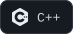</picture>
  <picture><source media="(prefers-color-scheme: dark)" srcset="./assets/icons/csharp.svg" /><source media="(prefers-color-scheme: light)" srcset="./assets/icons/light/csharp.svg" />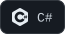</picture>
  <picture><source media="(prefers-color-scheme: dark)" srcset="./assets/icons/asm.svg" /><source media="(prefers-color-scheme: light)" srcset="./assets/icons/light/asm.svg" />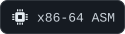</picture>
  <picture><source media="(prefers-color-scheme: dark)" srcset="./assets/icons/python.svg" /><source media="(prefers-color-scheme: light)" srcset="./assets/icons/light/python.svg" />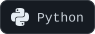</picture>
  <picture><source media="(prefers-color-scheme: dark)" srcset="./assets/icons/java.svg" /><source media="(prefers-color-scheme: light)" srcset="./assets/icons/light/java.svg" />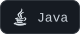</picture>
  <picture><source media="(prefers-color-scheme: dark)" srcset="./assets/icons/kotlin.svg" /><source media="(prefers-color-scheme: light)" srcset="./assets/icons/light/kotlin.svg" />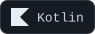</picture>
  <picture><source media="(prefers-color-scheme: dark)" srcset="./assets/icons/ruby.svg" /><source media="(prefers-color-scheme: light)" srcset="./assets/icons/light/ruby.svg" /></picture>

### setup

  <picture><source media="(prefers-color-scheme: dark)" srcset="./assets/icons/git.svg" /><source media="(prefers-color-scheme: light)" srcset="./assets/icons/light/git.svg" />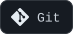</picture>
  <picture><source media="(prefers-color-scheme: dark)" srcset="./assets/icons/github.svg" /><source media="(prefers-color-scheme: light)" srcset="./assets/icons/light/github.svg" /></picture>
  <picture><source media="(prefers-color-scheme: dark)" srcset="./assets/icons/linux.svg" /><source media="(prefers-color-scheme: light)" srcset="./assets/icons/light/linux.svg" />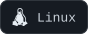</picture>
  <picture><source media="(prefers-color-scheme: dark)" srcset="./assets/icons/windows.svg" /><source media="(prefers-color-scheme: light)" srcset="./assets/icons/light/windows.svg" />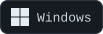</picture>
  <picture><source media="(prefers-color-scheme: dark)" srcset="./assets/icons/vscodium.svg" /><source media="(prefers-color-scheme: light)" srcset="./assets/icons/light/vscodium.svg" />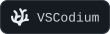</picture>
  <picture><source media="(prefers-color-scheme: dark)" srcset="./assets/icons/powershell.svg" /><source media="(prefers-color-scheme: light)" srcset="./assets/icons/light/powershell.svg" />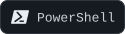</picture>

### contact

  <a href="https://discord.com/users/1471313815852290158"><picture><source media="(prefers-color-scheme: dark)" srcset="./assets/icons/discord.svg" /><source media="(prefers-color-scheme: light)" srcset="./assets/icons/light/discord.svg" /></picture></a>
  <a href="mailto:meow@intellense.io"><picture><source media="(prefers-color-scheme: dark)" srcset="./assets/icons/email.svg" /><source media="(prefers-color-scheme: light)" srcset="./assets/icons/light/email.svg" /></picture></a>

